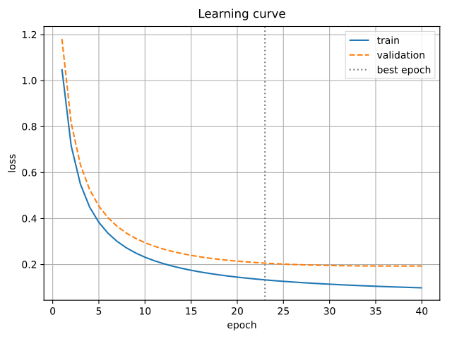
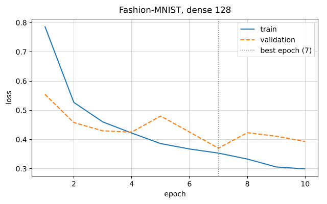
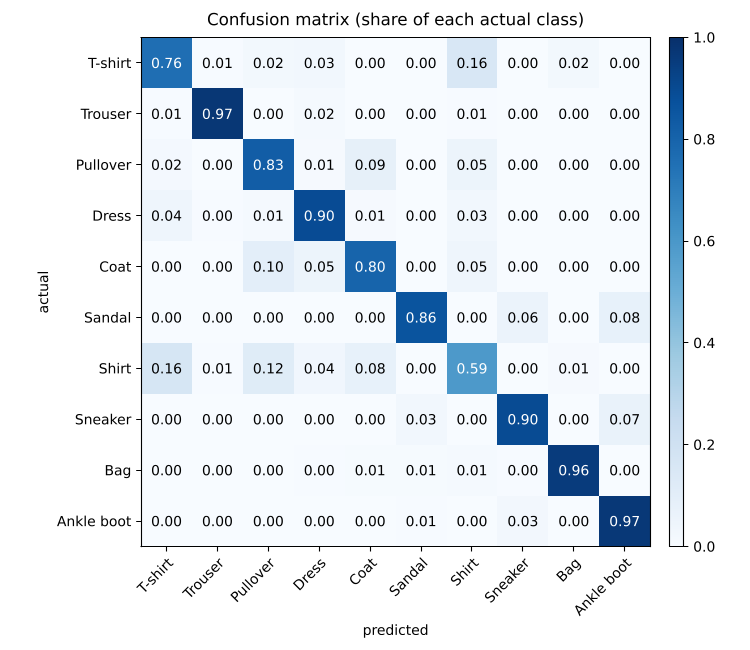

# clay-plot

Charts and figures for [Clay](https://github.com/mseminatore/clay), in the style of
matplotlib's `pyplot`: line plots, scatter plots, bar charts, histograms, pies, stacked areas,
error bars, images and heatmaps, log scales, subplots, legends, colour bars and colormaps.
Figures are saved as PNG, drawn anti-aliased by
[clay-image](https://github.com/mseminatore/clay-image), or as SVG, which any browser shows
and which web pages and Markdown can embed, or drawn in the terminal, live as a network trains.

If you know matplotlib, you already know most of it: the function names, format strings
(`"r--"`, `"o-"`), colour names (`"C1"`, `"tab:orange"`), colormaps (`"viridis"`) and
defaults are matplotlib's. Keyword arguments become an options Dict at the end.

```clay
import("plot")

epochs = (1..40) toArray
Plot plot(epochs, train, #{label: "train"})
Plot plot(epochs, valid, "--", #{label: "validation"})
Plot xlabel("epoch"); Plot ylabel("loss"); Plot title("Learning curve")
Plot grid; Plot legend
Plot savefig("loss.png")            // or "loss.svg"
```



```clay
[fig, axs] = Plot subplots(2, 2, #{figsize: [9, 7]})
axs at(0) at(0) bar(["cat", "dog", "bird", "fish"], [12, 30, 7, 18], #{color: "C1"})
axs at(0) at(1) hist(samples, 30, #{alpha: 0.8, label: "N(0, 1)"})
sc = axs at(1) at(0) scatter(px, py, #{c: py, cmap: "plasma", s: 20})
axs at(1) at(0) colorbar(sc, #{label: "y"})
axs at(1) at(1) imshow(grid, #{cmap: "coolwarm"})
axs at(1) at(1) colorbar
fig suptitle("Subplots")
fig savefig("subplots.svg")
```


## From matplotlib

| matplotlib | clay-plot |
|---|---|
| `import matplotlib.pyplot as plt` | `import("plot")`, then `Plot ...` (or `plt = Plot`) |
| `plt.plot(x, y, "r--", label="a", lw=2)` | `Plot plot(x, y, "r--", #{label: "a", lw: 2})` |
| `fig, ax = plt.subplots()` | `[fig, ax] = Plot subplots` |
| `fig, axs = plt.subplots(2, 3)` | `[fig, axs] = Plot subplots(2, 3)`, then `axs at(r) at(c)` |
| `plt.subplot(1, 2, 1)` | `Plot subplot(1, 2, 1)` |
| `ax.set_title("t")`, `ax.set_xlabel("x")` | `ax title("t")`, `ax xlabel("x")` |
| `ax.set(xlim=(0, 1), title="t")` | `ax set(#{xlim: [0, 1], title: "t"})` |
| `plt.fill_between(x, y1, y2)` | `Plot fillBetween(x, y1, y2)` |
| `n, bins, patches = plt.hist(x, 20)` | `[n, bins, patches] = Plot hist(x, 20)` |
| `plt.pie(v, labels=l, autopct="%1.1f%%")` | `Plot pie(v, #{labels: l, autopct: "%1.1f%%"})` |
| `ax.bar_label(bars, fmt="{:,.0f}")` | `ax barLabel(bars, #{fmt: "{:,.0f}"})` |
| `plt.errorbar(x, y, yerr=e, fmt="o")` | `Plot errorbar(x, y, #{yerr: e, fmt: "o"})` |
| `plt.yscale("log")`, `plt.semilogy(x, y)` | `Plot yscale("log")`, `Plot semilogy(x, y)` |
| `plt.xticks(pos, labels, rotation=45)` | `Plot xticks(pos, labels, #{rotation: 45})` |
| `plt.text(0.5, 0.5, "s", transform=ax.transAxes)` | `Plot text(0.5, 0.5, "s", #{transform: "axes"})` |
| `ax.annotate("max", xy=(x, y), xytext=(tx, ty), arrowprops=dict(arrowstyle="->"))` | `ax annotate("max", [x, y], [tx, ty], #{arrowprops: #{arrowstyle: "->"}})` |
| `ax2 = ax.twinx()` | `ax2 = ax twinx` |
| `plt.boxplot([a, b], tick_labels=["a", "b"], patch_artist=True)` | `Plot boxplot([a, b], #{labels: ["a", "b"], patchArtist: true})` |
| `plt.violinplot([a, b], showmedians=True)` | `Plot violinplot([a, b], #{showmedians: true})` |
| `plt.rcParams["font.size"] = 12` | `Plot rc set("font.size", 12)` |
| `plt.savefig("f.png", dpi=150)`, `plt.show()`, `plt.close()` | `Plot savefig("f.png", #{dpi: 150})`, `Plot show`, `Plot close` |

`Plot` keeps a current figure and axes, as pyplot does: `Plot plot(...)` draws on
`Plot gca`, made when first needed. `Plot figure(#{figsize: [w, h], dpi: 100})` starts a new
one. You can also work with the objects directly: `fig = Plot figure`, `ax = Plot gca`, then
`ax plot(...)`, `fig savefig(...)`.

## API

### Drawing

Each of these is a method of an axes (`ax plot(...)`) and of `Plot` (the current axes). They
return the artist they add, a Dict (`line get("color")`, `line set("label", "new")`).

| | |
|---|---|
| `plot(ys)`, `plot(xs, ys)`, `plot(xs, ys, fmt)` | Lines and markers. Options: `color`, `label`, `linewidth` (`lw`), `linestyle` (`ls`), `marker`, `markersize` (`ms`), `markerfacecolor`, `markeredgecolor`, `alpha`. `nil` (or `nan`) values leave a gap. Rows of numbers (`net history`) plot one line per column; `label` may then be an Array. |
| `scatter(xs, ys, opts)` | Markers. `s`: area in points² (one number or one per point); `c`: a colour, a colour per point, or a number per point mapped through `cmap` (with `vmin`, `vmax`); `marker`, `alpha`, `edgecolors`, `label`. |
| `bar(xs, heights, opts)` | Vertical bars. `xs` may be strings, which label bars at 0, 1, 2, ... Options: `width` (0.8), `bottom`, `align` (`"center"` or `"edge"`), `color` (one, or one per bar), `edgecolor`, `linewidth`, `label`, `alpha`. |
| `barh(ys, widths, opts)` | Horizontal bars; `height` and `left` instead of `width` and `bottom`. Category labels read top to bottom. |
| `hist(values, bins, opts)` | A histogram. `bins` is a count (10) or an Array of edges. Options: `bins`, `range: [lo, hi]`, `density`, `histtype` (`"bar"` or `"step"`), `color`, `alpha`, `label`. Returns `[counts, edges, artist]`. |
| `fillBetween(xs, y1, y2, opts)` | Shades between two curves (`y2` is 0 if left out, or a number). `color`, `alpha`, `edgecolor`, `label`. |
| `step(xs, ys, fmt, opts)` | A step line. `where`: `"pre"` (the default), `"post"` or `"mid"`; and `plot`'s options. |
| `errorbar(xs, ys, opts)` | Points or a line with error bars. `yerr`, `xerr`: a number, one per point, or `[lows, highs]`; `fmt` (`"o"`, `"s--"`; `"none"` for bars only), `capsize` (points), `ecolor`, `elinewidth`, and `plot`'s options. Returns `[line, bars]`. |
| `axhline(y, opts)`, `axvline(x, opts)` | A line across the whole axes. `color`, `linestyle`, `linewidth`, `alpha`, `label`. |
| `text(x, y, s, opts)` | Text at data coordinates, or axes fractions with `transform: "axes"`. `fontsize`, `color`, `ha` (`"left"`, `"center"`, `"right"`), `va` (`"baseline"`, `"center"`, `"top"`, `"bottom"`), `rotation`, `fontweight`. |
| `annotate(s, xy, xytext, opts)` | Text at `xytext` with an arrow to `xy` (`[x, y]` each; without `xytext` the text goes at `xy`). `xycoords` and `textcoords`: `"data"` (the default), `"axes fraction"`, `"figure fraction"`, or for the text `"offset points"` from `xy`. `arrowprops: #{arrowstyle:, color:, linewidth:, linestyle:, shrink:, shrinkA:, shrinkB:}` draws the arrow; `arrowstyle` is `"-|>"` (the default), `"->"`, `"-"`, `"<-"`, `"<->"`, `"<|-"` or `"<|-|>"`. `bbox: #{fc:, ec:, lw:, pad:, alpha:}` puts a box behind the text. Also `fontsize`, `color`, `ha`, `va`, `fontweight`. |
| `imshow(data, opts)` | An image or heatmap: rows of numbers (through `cmap`, scaled to `vmin`..`vmax`; `nil` and `nan` cells are transparent) or rows of `[r, g, b]` or `[r, g, b, a]` pixels (0..1, or 0..255). A flat Array needs `shape: [rows, cols]` unless it is square: 784 numbers show as 28 x 28. An `Image` from [clay-image](https://github.com/mseminatore/clay-image) works too. Options: `cmap`, `vmin`, `vmax`, `aspect` (`"equal"` or `"auto"`), `origin` (`"upper"` or `"lower"`), `extent`. |
| `pie(values, opts)` | A pie chart (the axes become round, without a frame). `labels`, `colors`, `autopct` (`"%1.1f%%"`, `"{:.0f}%"` or a block given the percentage), `startangle` (degrees, anticlockwise from 3 o'clock), `counterclock`, `explode` (an offset per wedge), `radius`, `pctdistance` (0.6), `labeldistance` (1.1), `wedgeprops: #{width:, edgecolor:, linewidth:}` (a `width` makes a donut), `textprops: #{fontsize:, color:}`. Returns `[wedges, texts, autotexts]`; `legend` lists the wedges. |
| `stackplot(xs, [ys1, ys2, ...], opts)` | Stacked areas, bottom first (the series may also be separate arguments). `labels`, `colors`, `alpha`, `edgecolor`, `baseline` (`"zero"` or `"sym"`). Returns the areas. |
| `boxplot(data, opts)` | Box plots of one data set (an Array of numbers), several (an Array of Arrays) or named ones (a Dict; its keys label the boxes). Boxes run from the first to the third quartile (numpy's quantiles) with a line at the median; whiskers reach the furthest data within `whis` box lengths (1.5), or `whis: [5, 95]` percentiles, and points beyond are fliers. Options: `positions`, `widths` (0.5), `labels`, `orientation` (`"vertical"` or `"horizontal"`; `vert: false` works too), `notch`, `showmeans`, `showfliers`, `showcaps`, `showbox`, `sym` (`""` hides fliers), `patchArtist` (filled boxes), `colors` (a fill per box), `label`, and matplotlib's `boxprops`, `medianprops`, `whiskerprops`, `capprops`, `flierprops`, `meanprops`. Returns the artist; `get("stats")` has each box's numbers. |
| `violinplot(data, opts)` | The shape of each data set's distribution (a Gaussian kernel density estimate), mirrored about its position. Data as for `boxplot`. Options: `positions`, `widths` (0.5), `labels`, `orientation`, `showextrema` (true), `showmeans`, `showmedians`, `quantiles` (`[0.25, 0.75]` for every set, or one list per set), `points` (100), `bwMethod` (`"scott"`, `"silverman"` or a number), `color`, `colors`, `alpha` (0.3), `label`. |
| `barLabel(bars, opts)` | Write values on the bars `bar`, `barh` or `hist` returned. `fmt` (`"%g"`, `"%d%%"`, `"{:,.0f}"`, or a block), `labels` (your own text instead), `labelType` (`"edge"` or `"center"`), `padding` (points), `fontsize`, `color`. |
| `colorbar(artist, opts)` | A colour bar beside the axes for an image or a colour-mapped scatter (the last one if you leave the artist out). `label`. |

### Labels and settings

| | |
|---|---|
| `title(s, opts)` | `fontsize`, `loc` (`"center"`, `"left"`, `"right"`) |
| `xlabel(s)`, `ylabel(s)` | Axis labels |
| `xlim(lo, hi)`, `ylim(lo, hi)` | Set the range shown (`nil` keeps an end automatic; an Array works too). With no arguments, returns the range in use. |
| `xticks(values, labels, opts)`, `yticks(...)` | Choose the ticks; `labels` names them, `rotation` turns them. `xticks([])` hides them. |
| `grid(on, opts)` | Grid lines at the ticks: `grid`, `grid(false)`, `grid(#{axis: "y", color:, linestyle:, alpha:})` |
| `legend(opts)`, `legend(labels)` | A legend of the labelled artists. `loc`: `"best"` (the default: the corner covering the least data), `"upper right"`, `"upper left"`, `"lower left"`, `"lower right"`, `"right"`, `"center left"`, `"center right"`, `"lower center"`, `"upper center"`, `"center"`. Also `fontsize`, `title`, `framealpha`. An Array of labels names the artists in order. |
| `twinx`, `twiny` | A second axes over this one sharing its x axis, with its own y axis on the right (`twinx`); or sharing y, with an x axis along the top (`twiny`). Returns the new axes (`Plot twinx` also makes it current). The two share one colour cycle and one title, and a legend on either lists the labelled artists of both. |
| `axis(mode)` | `"off"` hides the frame, ticks and labels; `"equal"` makes a unit the same length on both axes; `"auto"`; `"tight"`; or `[x0, x1, y0, y1]`. |
| `invertYaxis` | Turn the y axis upside down |
| `xscale(kind)`, `yscale(kind)` | `"log"` or `"linear"`. Log axes are ticked at powers of ten (with minor ticks between) and leave out values at or below zero. `semilogy(...)`, `semilogx(...)` and `loglog(...)` are `plot` on log axes. |
| `set(opts)` | Several at once: `title`, `xlabel`, `ylabel`, `xlim`, `ylim`, `xticks`, `yticks`, `xscale`, `yscale`, `aspect` |

### Figures

| | |
|---|---|
| `Plot figure(opts)` | A new current figure. `figsize: [width, height]` in inches (6.4 x 4.8), `dpi` (100), `facecolor`. |
| `Plot subplots(rows, cols, opts)` | A new figure with a grid of axes: `[fig, axs]`. As in matplotlib, `axs` is one axes for 1 x 1, an Array for one row or column, and an Array of rows otherwise. |
| `Plot subplot(rows, cols, index)` | Make the axes at `index` (1-based, along rows) of the current figure current, adding it if needed |
| `Plot gcf`, `Plot gca`, `Plot sca(ax)` | The current figure and axes; make an axes current |
| `fig axes`, `fig ax(row, col)` | All the figure's axes; the one at a grid position |
| `suptitle(s, opts)` | A title above all the subplots |
| `savefig(path, opts)` | Save; the extension picks the format, `.png` or `.svg`. `opts`: `dpi`, to save at another resolution than the figure's (`#{dpi: 200}` for print). |
| `toPng(dpi)`, `toSvg(dpi)` | The figure as a PNG file's bytes or as SVG text, e.g. to return from a web handler |
| `toCanvas(dpi)` | The figure drawn on a clay-image `Canvas`, to draw more on it, or `toImage` for an `Image` |
| `show` | Save to a temporary PNG and open it in the system's image viewer. `Plot show` then starts a fresh figure, as pyplot does. Returns the file's path. |
| `Plot close`, `Plot clf` | Forget the current figure; clear its axes |
| `Plot rc` | The default settings, a Dict named as matplotlib's rcParams: `figure.figsize`, `figure.dpi`, `font.size`, `axes.titlesize`, `axes.labelsize`, `xtick.labelsize`, `ytick.labelsize`, `legend.fontsize`, `lines.linewidth`, `lines.markersize`, `axes.linewidth`, `axes.grid`, `axes.xmargin`, `axes.ymargin`, `grid.color`, `grid.linewidth`, `grid.alpha`, `image.cmap` |

Layout is automatic, like matplotlib's tight layout: each axes gets the room its tick labels,
axis labels, title and colour bar need, and subplots in one column or row line up.

### Format strings

A format string is any of a colour, a marker and a line style, in any order: `"r"`, `"o"`
(markers only), `"g^-"`, `"k--"`, `"b.:"`.

- Colours: `b` `g` `r` `c` `m` `y` `k` `w`
- Markers: `.` `,` `o` `s` `^` `v` `<` `>` `D` `d` `p` `h` `*` `+` `x` `|` `_`
- Lines: `-` solid, `--` dashed, `:` dotted, `-.` dash-dot (and `"none"` as a `linestyle`)

### Colours and colormaps

A colour is any of `"#1f77b4"`, `"#abc"`, the one-letter colours, `"C0"` to `"C9"` (the
default cycle, tab10), `"tab:blue"` and the other tab10 names, common CSS names
(`"steelblue"`, `"crimson"`, ...), a gray level as a string (`"0.75"`), or `[r, g, b]` in 0..1.
Lines, bars and fills without a colour take the next one in the cycle.

Colormaps: `viridis` (the default), `plasma`, `inferno`, `magma`, `cividis`, `gray`, `binary`,
`Greys`, `Blues`, `Reds`, `Greens`, `coolwarm`, `RdBu`; add `_r` to reverse one
(`"gray_r"`). `PlotColor colormap("viridis", 0.3)` gives the `[r, g, b]` at a point, and
`PlotColor hex(spec)` turns any colour into `"#rrggbb"`.

## Dashboards

Pies and donuts, stacked bars with their totals, stacked areas, error bars and log scales,
from [`examples/dashboard.clay`](examples/dashboard.clay):

```clay norun
ax pie(shares, #{labels: ["Web", "Store", "Phone"], autopct: "%1.1f%%", startangle: 90})
ax pie(browsers, #{autopct: "{:.0f}%", wedgeprops: #{width: 0.4, edgecolor: "white"}})   // a donut

ax bar(months, web, #{label: "Web"})                       // stacked bars: bottom is the bars below
top = ax bar(months, store, #{bottom: web, label: "Store"})
ax barLabel(top, #{fmt: "{:,.0f}", padding: 2})

ax stackplot(days, [web, store, phone], #{labels: ["Web", "Store", "Phone"]})
ax errorbar(xs, ys, #{yerr: errs, fmt: "o", capsize: 3})
ax yscale("log")
```


For grouped bars, shift each group's positions by a bar width, as in matplotlib:
`ax bar(xs map { |x| x - 0.2 }, a, #{width: 0.4})`, `ax bar(xs map { |x| x + 0.2 }, b, #{width: 0.4})`,
then `ax xticks(xs, names)`.

## Machine learning

Plots for training and evaluating models, in the style of scikit-learn's displays. They take
plain Arrays of numbers (or anything with `toArray`, such as clay-ann's `AnnData`), so they work
with [clay-ann](https://github.com/mseminatore/clay-ann) without depending on it. The figures
below are from [`examples/fashion_mnist.clay`](examples/fashion_mnist.clay): a small network
trained on Fashion-MNIST with clay-ann.

| | |
|---|---|
| `learningCurve(history, opts)` | Loss per epoch, from what clay-ann's `fit` returns (a Dict per epoch), `net history` rows (`[loss, learningRate, validationLoss]`, -1 for none), an Array of losses, or a Dict of named series (`#{loss: [...], accuracy: [...]}`). Marks the best epoch: the lowest validation loss (or training loss); `best:` an epoch number or `false`. Also `title`, `xlabel`, `ylabel`. |
| `confusionMatrix(matrix, opts)` | A confusion matrix (rows: actual class) as a heatmap with its values in the cells, in black or white to stand out. `labels` (class names), `normalize` (`"true"`: each row sums to 1, `"pred"`: columns, `"all"`), `cmap` (`"Blues"`), `colorbar` (`true`), `annotate` (`true` up to 30 classes), `rotation` (of the x labels), `title`. |
| `roc(scores, targets, opts)` | ROC curves with their AUC. `scores` are numbers (higher: more likely positive) with targets 1/0 or true/false, or rows of class scores (one curve per class, one against the rest) with targets as class numbers or one-hot rows. `labels`, `label`, `chance` (`true`: the diagonal), `title`. Returns the curve, `#{fpr:, tpr:, thresholds:, auc:}`, or one per class. |
| `precisionRecall(scores, targets, opts)` | Precision-recall curves with their average precision, the same way. Returns `#{precision:, recall:, thresholds:, ap:}` (or one per class). |
| `Plot imageGrid(images, opts)` | A new figure of images, one per axes: rows, flat Arrays or `Image`s. `cols` (up to 10), `shape`, `cmap` (`"gray"`), `vmin`, `vmax`, `symmetric` (`true`: one range centred on 0 for all, with `"coolwarm"`, for weights and filters), `titles`, `predicted` and `actual` (class numbers or rows of scores: titled with the prediction, and the actual class in red when wrong), `labels` (class names), `title`, `size` (inches per image). Returns the figure. |

The first four are axes methods too (`ax roc(...)`). `PlotML rocCurve(scores, targets)`,
`PlotML prCurve(scores, targets)` and `PlotML confusion(actual, predicted)` compute without
drawing, and `PlotML argmax(row)` is the class a row of scores picks.

```clay
history = net fit(xTrain, yTrain, #{"epochs": 12, "validation": [xValid, yValid], "patience": 3})
Plot learningCurve(history)
Plot savefig("history.png")
```



```clay
names = ["T-shirt", "Trouser", "Pullover", "Dress", "Coat", "Sandal", "Shirt", "Sneaker", "Bag", "Ankle boot"]
Plot figure(#{figsize: [7.5, 6.5]})
Plot confusionMatrix(net confusionMatrix(xTest, yTest), #{labels: names, normalize: "true", rotation: 45})
```



```clay
probs = (net predictBatch(xTest)) toArray      // a row of 10 probabilities per image
Plot roc(probs, labels, #{labels: names})       // labels: the class number of each image
```


```clay
guesses = probs map { |p| PlotML argmax(p) }
Plot imageGrid((0..29) map { |k| xTest row(k) }, #{cols: 10, predicted: guesses slice(0, 30),
               actual: labels slice(0, 30), labels: names})
```


Weight matrices, convolution filters and spectrograms are `imshow` too: a diverging map such
as `coolwarm` with `vmin: -m, vmax: m` suits weights, and `Plot imageGrid(filters,
#{symmetric: true})` shows a layer's filters on one shared scale. A spectrogram, one row per
mel band, lowest band at the bottom:

```clay
Plot figure(#{figsize: [8, 3.5]})
Plot imshow(spec, #{origin: "lower", aspect: "auto", cmap: "magma"})
Plot colorbar(#{label: "dB"})
Plot xlabel("frame"); Plot ylabel("mel band")
```


## In the terminal

Any figure can be drawn as text: lines, markers and fills in Braille dots (2 x 4 to a
character), images in half blocks, all in 24-bit colour. It suits SSH sessions and watching a
network train.

```clay
Plot plot(epochs, train, #{label: "train"})
Plot plot(epochs, valid, "--", #{label: "validation"})
Plot title("Learning curve"); Plot legend
Plot show(#{terminal: true})        // or: Plot toText(#{cols: 64, rows: 16}) print
```

```text

                           Learning curve
      ⢠⠤⠤⠤⠤⠤⠤⠤⠤⠤⠤⠤⠤⠤⠤⠤⠤⠤⠤⠤⠤⠤⠤⠤⠤⠤⠤⠤⠤⠤⠤⠤⠤⠤⠤⠤⠤⠤⠤⠤⠤⠤⠤⠤⠤⠤⠤⠤⠤⠤⠤⠤⠤⠤⠤⢤
      ⢸  ⡇                                 ⢸⠉⠉⠉⠉⠉⠉⠉⠉⠉⠉⠉⠉⠉⠉⠉⠉⢹⢸
  1.0 ⢸  ⣏                                 ⢸⠉⠉⠉⠉⠁ train     ⢸⢸
      ⢸  ⢸⡆                                ⢸⠤⠤⠄⠠⠄ validation⢸⢸
      ⢸  ⠈⣦                                ⠸⠤⠤⠤⠤⠤⠤⠤⠤⠤⠤⠤⠤⠤⠤⠤⠤⠼⢸
      ⢸   ⢹⠄                                                 ⢸
  0.5 ⢸   ⠈⢲⠢⡀                                               ⢸
      ⢸     ⠑⢆⡢⠤⡀                                            ⢸
      ⢸       ⠈⠑⠒⠬⠭⣇⣀⣒⡒ ⠠⠤⠄ ⠤⠤⠄⢀⣀⣀ ⣀⣀⡀⢀⣀⣀⢀⣀⣀⡀⣀⣀⣀⢀⣀⣀⡀⢀⣀⣀ ⣀⣀   ⢸
      ⢸               ⠈⠉⠉⠉⠉⠉⠑⠒⠒⠒⠒⠒⠒⠒⠒⠒⠒⠒⠒⠒⠤⠤⠤⠤⠤⠤⠤⠤⠤⠤⠤⠤⠤⠤⠤⠤⠤⠄ ⢸
      ⠈⠉⠉⠉⠉⠉⠉⠉⠉⠉⠉⠉⠉⠉⠉⠉⠉⠉⠉⠉⠉⠉⠉⠉⠉⠉⠉⠉⠉⠉⠉⠉⠉⠉⠉⠉⠉⠉⠉⠉⠉⠉⠉⠉⠉⠉⠉⠉⠉⠉⠉⠉⠉⠉⠉⠉
       0        5       10      15       20       25      30

                                epoch
```

| | |
|---|---|
| `toText(opts)` | The figure (`fig toText`, or `Plot toText` for the current one) as a String of lines. `cols` (the `COLUMNS` variable, or 80), `rows` (from the figure's shape, at most `LINES` - 1), `color` (`true` when writing to a terminal; `false` for plain text). |
| `show(#{terminal: true})` | Print it rather than open a viewer. On Linux without a display (`DISPLAY` and `WAYLAND_DISPLAY` unset), `show` does this by itself. |
| `Plot liveCurve(opts)` | A learning curve redrawn in place after every epoch: pass it as clay-ann `fit`'s `onEpoch`. Writing to a file or pipe instead, it prints a line per epoch. Options: `cols`, `rows` (20), `color`, `every` (redraw every n epochs), `title`, and `learningCurve`'s. `live savefig("loss.png")` saves the finished curve; `live history` has the epochs; `live value(loss)` adds one by hand. |

```clay
live = Plot liveCurve
history = net fit(xTrain, yTrain, #{"epochs": 30, "validation": [xValid, yValid], "onEpoch": live})
live savefig("history.png")
```

`examples/fashion_mnist.clay --live` shows it. Text is laid out at a size where 10-point type
is one row, so ticks, labels, legends and colour bars come out as in the pictures, at
character resolution. Black and white draw in the terminal's own text colour, so charts read on
dark and light backgrounds alike. The terminal needs a font with Braille characters (Windows
Terminal, macOS Terminal and most Linux terminals have one; the old Windows console host's
fonts do not).

## Limitations

- Text is DejaVu Sans only, in one weight (`fontweight` applies to SVG alone). SVG asks the
  viewer for DejaVu Sans and the layout measures text with it; a viewer without the font uses
  another sans-serif, which may sit a little closer or further than intended.
- In SVG, images are embedded as base64 PNG, about a third larger than the PNG itself (a
  128 x 400 spectrogram is about 200 KB).
- No contour plots, date axes, symlog scales or 3-D yet. Log axes label only powers of ten (and 1, 2, 5 when less than two decades show).

## Install

```sh
clay bricks add github.com/mseminatore/clay-plot plot
```

clay-plot depends on [clay-image](https://github.com/mseminatore/clay-image), a native brick:
its C code (stb_image, and its canvas) is compiled the first time it is imported, which needs a C compiler,
and `clay bricks add` asks before installing it.

## Develop

```sh
clay bricks install                # fetches clay-image into bricks/
clay tests/test_plot.clay          # a brick can import itself by name
clay examples/gallery.clay         # writes example figures to examples/out/
clay examples/ml.clay
clay examples/dashboard.clay
```

`examples/fashion_mnist.clay` also needs clay-ann; its header says how to run it.

The code is in `src/`: `main.clay` (`Plot`, the pyplot-style functions and `rc`),
`figure.clay` (`PlotFigure`: layout and saving), `axes.clay` (`PlotAxes`: artists, scales,
ticks, legend, drawing), `ticks.clay` (`PlotTicks`: ticks, number formats, logarithms),
`color.clay` (`PlotColor`), `ml.clay` (`PlotML`), `live.clay` (`PlotLive`), and the backends
`svg.clay` (`PlotSvg`), `png.clay` (`PlotPng`, on clay-image's `Canvas`) and `term.clay`
(`PlotTerm`, text for terminals). Axes
draw through a handful of primitives (`line`, `polyline`, `polygon`, `rect`, `circle`, `text`,
`image`, `clip`, `measure`) listed at the top of `svg.clay`, so a new backend implements just
those.

To work on clay-image at the same time, replace `bricks/image` with a link to your checkout
(`mklink /J bricks\image ..\clay-image` on Windows, `ln -s ../../clay-image bricks/image`
elsewhere).

`.github/workflows/test.yml` runs the tests on Linux, macOS and Windows for every push and
pull request on GitHub.
