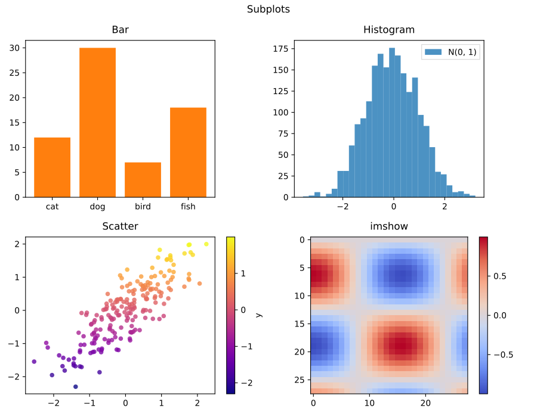
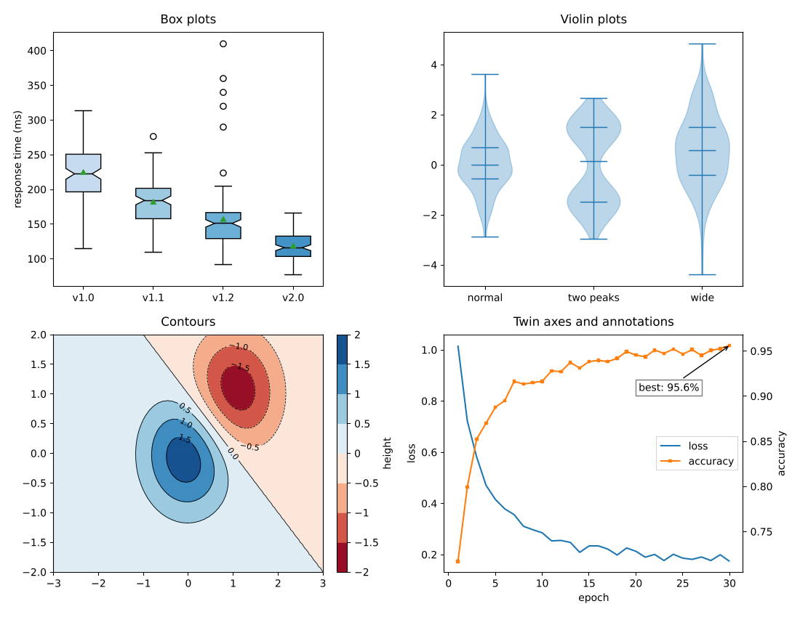
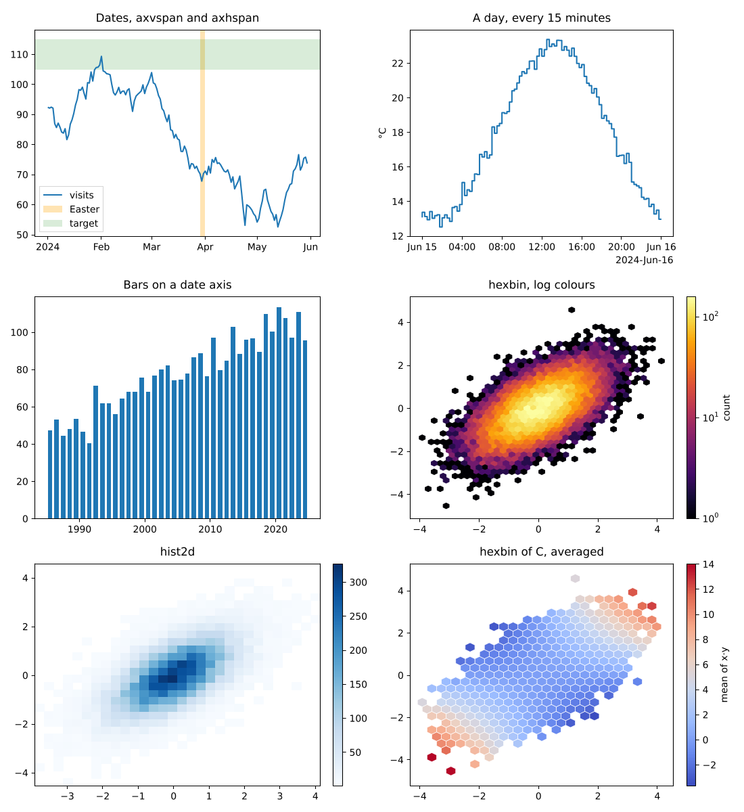

# clay-plot

Charts and figures for [Clay](https://github.com/mseminatore/clay): line plots, scatter plots,
bar charts, histograms, pies, stacked areas, error bars, images and heatmaps, contours, polar
and date axes, log scales, subplots, legends, colour bars and colormaps, plus plots for
training and evaluating machine-learning models. Figures are saved as PNG, drawn anti-aliased
by [clay-image](https://github.com/mseminatore/clay-image), as SVG, which any browser shows
and which web pages and Markdown can embed, as PDF (vector, by
[clay-pdf](https://github.com/mseminatore/clay-pdf)), alone or inside a larger document, or
drawn in the terminal, live as a network trains.

You draw through `Plot`, which keeps a current figure and axes, or on figure and axes objects
directly. Styles are short format strings (`"r--"`, `"o-"`), colours come from a named cycle
(`"C1"`, `"tab:orange"`) and colormaps (`"viridis"`), and options go in a Dict at the end of a
call. If you've plotted in Python, it will feel familiar: see
[Coming from Python](docs/coming-from-python.md).

```clay
import("plot")

epochs = (1..40) toArray
Plot plot(epochs, train, #{label: "train"})
Plot plot(epochs, valid, "--", #{label: "validation"})
Plot xlabel("epoch"); Plot ylabel("loss"); Plot title("Learning curve")
Plot grid; Plot legend
Plot savefig("loss.png")            // or "loss.svg", "loss.pdf"
```


```clay
[fig, axs] = Plot subplots(2, 2, #{figsize: [9, 7]})
axs at(0) at(0) bar(["cat", "dog", "bird", "fish"], [12, 30, 7, 18], #{color: "C1"})
axs at(0) at(1) hist(samples, 30, #{alpha: 0.8, label: "N(0, 1)"})
sc = axs at(1) at(0) scatter(px, py, #{c: py, cmap: "plasma", s: 20})
axs at(1) at(0) colorbar(sc, #{label: "y"})
axs at(1) at(1) imshow(grid, #{cmap: "coolwarm"})
axs at(1) at(1) colorbar
fig suptitle("Subplots")
fig savefig("subplots.svg")
```



## Gallery

| | | |
|---|---|---|
| [](docs/guide.md#dashboards) | [](docs/guide.md#distributions-fields-and-annotations) | [](docs/guide.md#fields-and-polar-axes) |
| [](docs/ml.md) | [](docs/guide.md#dates-and-densities) | [](docs/output.md#animation) |

## Documentation

- [Guide](docs/guide.md): plot types by example: dashboards, distributions, contours, layout
  and math text, fields, polar axes, dates and densities
- [API reference](docs/api.md): drawing functions, labels and settings, figures, format
  strings, colours and colormaps, and limitations
- [Machine learning](docs/ml.md): learning curves, confusion matrices, ROC and
  precision-recall curves, decision boundaries, embeddings and image grids
- [Output](docs/output.md): animated GIFs and PNGs, drawing in the terminal, and PDF documents
- [Coming from Python](docs/coming-from-python.md): Python plotting calls side by side with
  clay-plot's
- [Contributing](CONTRIBUTING.md): building, testing and how the code is laid out

## Limitations

- No 3-D plots or symlog scales yet, and dates go on the x axis only.
- Text is DejaVu Sans only (Helvetica in PDF), in one weight.
- Math text covers a subset of TeX: no stacked fractions, roots or matrices.

See the [full list](docs/api.md#limitations).


## Install

```sh
clay bricks add github.com/mseminatore/clay-plot plot
```

It needs Clay 0.3.7 or later. clay-plot depends on [clay-pdf](https://github.com/mseminatore/clay-pdf) (pure Clay) and [clay-image](https://github.com/mseminatore/clay-image), a native brick:
its C code (stb_image, and its canvas) is compiled the first time it is imported, which needs a C compiler,
and `clay bricks add` asks before installing it.
