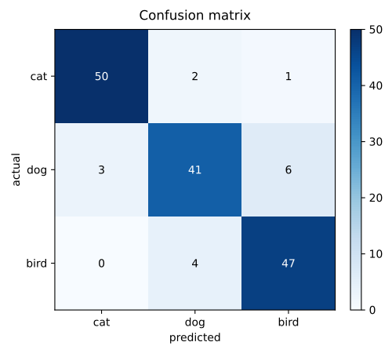
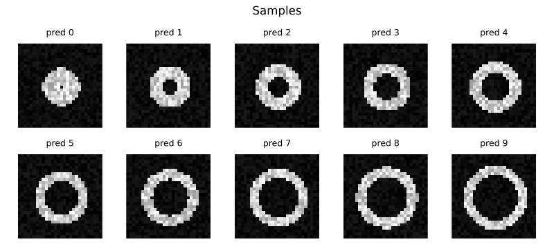

# clay-plot

Charts and figures for [Clay](https://github.com/mseminatore/clay), in the style of
matplotlib's `pyplot`: line plots, scatter plots, bar charts, histograms, images and heatmaps,
subplots, legends, colour bars and colormaps. Figures are saved as SVG, which any browser
shows and which web pages and Markdown can embed.

If you know matplotlib, you already know most of it: the function names, format strings
(`"r--"`, `"o-"`), colour names (`"C1"`, `"tab:orange"`), colormaps (`"viridis"`) and
defaults are matplotlib's. Keyword arguments become an options Dict at the end.

```clay
import("plot")

epochs = (1..40) toArray
Plot plot(epochs, train, #{label: "train"})
Plot plot(epochs, valid, "--", #{label: "validation"})
Plot xlabel("epoch"); Plot ylabel("loss"); Plot title("Learning curve")
Plot grid; Plot legend
Plot savefig("loss.svg")
```


```clay
[fig, axs] = Plot subplots(2, 2, #{figsize: [9, 7]})
axs at(0) at(0) bar(["cat", "dog", "bird", "fish"], [12, 30, 7, 18], #{color: "C1"})
axs at(0) at(1) hist(samples, 30, #{alpha: 0.8, label: "N(0, 1)"})
sc = axs at(1) at(0) scatter(px, py, #{c: py, cmap: "plasma", s: 20})
axs at(1) at(0) colorbar(sc, #{label: "y"})
axs at(1) at(1) imshow(grid, #{cmap: "coolwarm"})
axs at(1) at(1) colorbar
fig suptitle("Subplots")
fig savefig("subplots.svg")
```


## From matplotlib

| matplotlib | clay-plot |
|---|---|
| `import matplotlib.pyplot as plt` | `import("plot")`, then `Plot ...` (or `plt = Plot`) |
| `plt.plot(x, y, "r--", label="a", lw=2)` | `Plot plot(x, y, "r--", #{label: "a", lw: 2})` |
| `fig, ax = plt.subplots()` | `[fig, ax] = Plot subplots` |
| `fig, axs = plt.subplots(2, 3)` | `[fig, axs] = Plot subplots(2, 3)`, then `axs at(r) at(c)` |
| `plt.subplot(1, 2, 1)` | `Plot subplot(1, 2, 1)` |
| `ax.set_title("t")`, `ax.set_xlabel("x")` | `ax title("t")`, `ax xlabel("x")` |
| `ax.set(xlim=(0, 1), title="t")` | `ax set(#{xlim: [0, 1], title: "t"})` |
| `plt.fill_between(x, y1, y2)` | `Plot fillBetween(x, y1, y2)` |
| `n, bins, patches = plt.hist(x, 20)` | `[n, bins, patches] = Plot hist(x, 20)` |
| `plt.xticks(pos, labels, rotation=45)` | `Plot xticks(pos, labels, #{rotation: 45})` |
| `plt.text(0.5, 0.5, "s", transform=ax.transAxes)` | `Plot text(0.5, 0.5, "s", #{transform: "axes"})` |
| `plt.rcParams["font.size"] = 12` | `Plot rc set("font.size", 12)` |
| `plt.savefig("f.svg")`, `plt.show()`, `plt.close()` | `Plot savefig("f.svg")`, `Plot show`, `Plot close` |

`Plot` keeps a current figure and axes, as pyplot does: `Plot plot(...)` draws on
`Plot gca`, made when first needed. `Plot figure(#{figsize: [w, h], dpi: 100})` starts a new
one. You can also work with the objects directly: `fig = Plot figure`, `ax = Plot gca`, then
`ax plot(...)`, `fig savefig(...)`.

## API

### Drawing

Each of these is a method of an axes (`ax plot(...)`) and of `Plot` (the current axes). They
return the artist they add, a Dict (`line get("color")`, `line set("label", "new")`).

| | |
|---|---|
| `plot(ys)`, `plot(xs, ys)`, `plot(xs, ys, fmt)` | Lines and markers. Options: `color`, `label`, `linewidth` (`lw`), `linestyle` (`ls`), `marker`, `markersize` (`ms`), `markerfacecolor`, `markeredgecolor`, `alpha`. `nil` (or `nan`) values leave a gap. Rows of numbers (`net history`) plot one line per column; `label` may then be an Array. |
| `scatter(xs, ys, opts)` | Markers. `s`: area in points² (one number or one per point); `c`: a colour, a colour per point, or a number per point mapped through `cmap` (with `vmin`, `vmax`); `marker`, `alpha`, `edgecolors`, `label`. |
| `bar(xs, heights, opts)` | Vertical bars. `xs` may be strings, which label bars at 0, 1, 2, ... Options: `width` (0.8), `bottom`, `align` (`"center"` or `"edge"`), `color` (one, or one per bar), `edgecolor`, `linewidth`, `label`, `alpha`. |
| `barh(ys, widths, opts)` | Horizontal bars; `height` and `left` instead of `width` and `bottom`. Category labels read top to bottom. |
| `hist(values, bins, opts)` | A histogram. `bins` is a count (10) or an Array of edges. Options: `bins`, `range: [lo, hi]`, `density`, `histtype` (`"bar"` or `"step"`), `color`, `alpha`, `label`. Returns `[counts, edges, artist]`. |
| `fillBetween(xs, y1, y2, opts)` | Shades between two curves (`y2` is 0 if left out, or a number). `color`, `alpha`, `edgecolor`, `label`. |
| `axhline(y, opts)`, `axvline(x, opts)` | A line across the whole axes. `color`, `linestyle`, `linewidth`, `alpha`, `label`. |
| `text(x, y, s, opts)` | Text at data coordinates, or axes fractions with `transform: "axes"`. `fontsize`, `color`, `ha` (`"left"`, `"center"`, `"right"`), `va` (`"baseline"`, `"center"`, `"top"`, `"bottom"`), `rotation`, `fontweight`. |
| `imshow(data, opts)` | An image or heatmap: rows of numbers (through `cmap`, scaled to `vmin`..`vmax`) or rows of `[r, g, b]` pixels (0..1, or 0..255). A flat Array needs `shape: [rows, cols]` unless it is square: 784 numbers show as 28 x 28. An `Image` from [clay-image](https://github.com/mseminatore/clay-image) works too. Options: `cmap`, `vmin`, `vmax`, `aspect` (`"equal"` or `"auto"`), `origin` (`"upper"` or `"lower"`), `extent`. |
| `colorbar(artist, opts)` | A colour bar beside the axes for an image or a colour-mapped scatter (the last one if you leave the artist out). `label`. |

### Labels and settings

| | |
|---|---|
| `title(s, opts)` | `fontsize`, `loc` (`"center"`, `"left"`, `"right"`) |
| `xlabel(s)`, `ylabel(s)` | Axis labels |
| `xlim(lo, hi)`, `ylim(lo, hi)` | Set the range shown (`nil` keeps an end automatic; an Array works too). With no arguments, returns the range in use. |
| `xticks(values, labels, opts)`, `yticks(...)` | Choose the ticks; `labels` names them, `rotation` turns them. `xticks([])` hides them. |
| `grid(on, opts)` | Grid lines at the ticks: `grid`, `grid(false)`, `grid(#{axis: "y", color:, linestyle:, alpha:})` |
| `legend(opts)`, `legend(labels)` | A legend of the labelled artists. `loc`: `"best"` (the default: the corner covering the least data), `"upper right"`, `"upper left"`, `"lower left"`, `"lower right"`, `"right"`, `"center left"`, `"center right"`, `"lower center"`, `"upper center"`, `"center"`. Also `fontsize`, `title`, `framealpha`. An Array of labels names the artists in order. |
| `axis(mode)` | `"off"` hides the frame, ticks and labels; `"equal"` makes a unit the same length on both axes; `"auto"`; `"tight"`; or `[x0, x1, y0, y1]`. |
| `invertYaxis` | Turn the y axis upside down |
| `set(opts)` | Several at once: `title`, `xlabel`, `ylabel`, `xlim`, `ylim`, `xticks`, `yticks`, `aspect` |

### Figures

| | |
|---|---|
| `Plot figure(opts)` | A new current figure. `figsize: [width, height]` in inches (6.4 x 4.8), `dpi` (100), `facecolor`. |
| `Plot subplots(rows, cols, opts)` | A new figure with a grid of axes: `[fig, axs]`. As in matplotlib, `axs` is one axes for 1 x 1, an Array for one row or column, and an Array of rows otherwise. |
| `Plot subplot(rows, cols, index)` | Make the axes at `index` (1-based, along rows) of the current figure current, adding it if needed |
| `Plot gcf`, `Plot gca`, `Plot sca(ax)` | The current figure and axes; make an axes current |
| `fig axes`, `fig ax(row, col)` | All the figure's axes; the one at a grid position |
| `suptitle(s, opts)` | A title above all the subplots |
| `savefig(path)` | Save; the extension picks the format: `.svg` |
| `toSvg` | The figure as SVG text, e.g. to return from a web handler |
| `show` | Save to a temporary file and open it in the system's viewer (usually the browser for SVG). `Plot show` then starts a fresh figure, as pyplot does. Returns the file's path. |
| `Plot close`, `Plot clf` | Forget the current figure; clear its axes |
| `Plot rc` | The default settings, a Dict named as matplotlib's rcParams: `figure.figsize`, `figure.dpi`, `font.size`, `axes.titlesize`, `axes.labelsize`, `xtick.labelsize`, `ytick.labelsize`, `legend.fontsize`, `lines.linewidth`, `lines.markersize`, `axes.linewidth`, `axes.grid`, `axes.xmargin`, `axes.ymargin`, `grid.color`, `grid.linewidth`, `grid.alpha`, `image.cmap` |

Layout is automatic, like matplotlib's tight layout: each axes gets the room its tick labels,
axis labels, title and colour bar need, and subplots in one column or row line up.

### Format strings

A format string is any of a colour, a marker and a line style, in any order: `"r"`, `"o"`
(markers only), `"g^-"`, `"k--"`, `"b.:"`.

- Colours: `b` `g` `r` `c` `m` `y` `k` `w`
- Markers: `.` `,` `o` `s` `^` `v` `<` `>` `D` `d` `p` `h` `*` `+` `x` `|` `_`
- Lines: `-` solid, `--` dashed, `:` dotted, `-.` dash-dot (and `"none"` as a `linestyle`)

### Colours and colormaps

A colour is any of `"#1f77b4"`, `"#abc"`, the one-letter colours, `"C0"` to `"C9"` (the
default cycle, tab10), `"tab:blue"` and the other tab10 names, common CSS names
(`"steelblue"`, `"crimson"`, ...), a gray level as a string (`"0.75"`), or `[r, g, b]` in 0..1.
Lines, bars and fills without a colour take the next one in the cycle.

Colormaps: `viridis` (the default), `plasma`, `inferno`, `magma`, `cividis`, `gray`, `binary`,
`Greys`, `Blues`, `Reds`, `Greens`, `coolwarm`, `RdBu`; add `_r` to reverse one
(`"gray_r"`). `PlotColor colormap("viridis", 0.3)` gives the `[r, g, b]` at a point, and
`PlotColor hex(spec)` turns any colour into `"#rrggbb"`.

## Recipes for neural networks

These use [clay-ann](https://github.com/mseminatore/clay-ann)'s results, but are only arrays
of numbers, so they work with any data.

**Learning curve.** `net history` has a row `[loss, learningRate, validationLoss]` per epoch,
with -1 where there was no validation data:

```clay
h = net history
Plot plot(h map { |r| r at(0) }, #{label: "train"})
Plot plot(h map { |r| (r at(2) < 0) ifTrue { nil } ifFalse { r at(2) } }, #{label: "validation"})
Plot xlabel("epoch"); Plot ylabel("loss"); Plot legend
Plot savefig("history.svg")
```

**Confusion matrix**, with counts in the cells:

```clay
cm = net confusionMatrix(xTest, yTest)
Plot imshow(cm, #{cmap: "Blues"})
Plot colorbar
cm size times { |r| cm size times { |c|
    v = cm at(r) at(c)
    Plot text(c, r, v toString, #{ha: "center", va: "center", color: (v > 500) ifTrue { "white" } ifFalse { "black" }})
} }
Plot xlabel("predicted"); Plot ylabel("actual")
```



**A grid of samples** (MNIST rows are 784 numbers, shown as 28 x 28):

```clay
[fig, axs] = Plot subplots(2, 5, #{figsize: [8, 3.6]})
10 times { |i|
    ax = axs at(i / 5) at(i % 5)
    ax imshow(xTest at(i), #{cmap: "gray"})
    ax title("pred " + (preds at(i)) toString, #{fontsize: 9})
    ax axis("off")
}
fig savefig("samples.svg")
```



Weight matrices, convolution filters and spectrograms are `imshow` too (a diverging map such
as `coolwarm` with `vmin: -m, vmax: m` suits weights).

## Limitations

- SVG is the only output format so far. PNG (through clay-image) is planned.
- SVG viewers measure the text, so the layout estimates text widths; unusual fonts may sit a
  little closer or further than intended.
- Images are drawn as SVG rectangles (runs of one colour merged), which suits MNIST-sized
  images and small heatmaps; very large images make large files until PNG embedding lands.
- No log scales, error bars, pie charts, contour plots or 3-D yet.

## Install

```sh
clay bricks add github.com/mseminatore/clay-plot plot
```

## Develop

```sh
clay tests/test_plot.clay          # a brick can import itself by name
clay examples/gallery.clay         # writes example figures to examples/out/
clay examples/ml.clay
```

The code is in `src/`: `main.clay` (`Plot`, the pyplot-style functions and `rc`),
`figure.clay` (`PlotFigure`: layout and saving), `axes.clay` (`PlotAxes`: artists, scales,
ticks, legend, drawing), `ticks.clay` (`PlotTicks`), `color.clay` (`PlotColor`) and `svg.clay`
(`PlotSvg`). Axes draw through a handful of primitives (`line`, `polyline`, `polygon`,
`rect`, `circle`, `text`, `pixels`, `clip`, `measure`) listed at the top of `svg.clay`, so a new
backend implements just those.

`.github/workflows/test.yml` runs the tests on Linux, macOS and Windows for every push and
pull request on GitHub.
