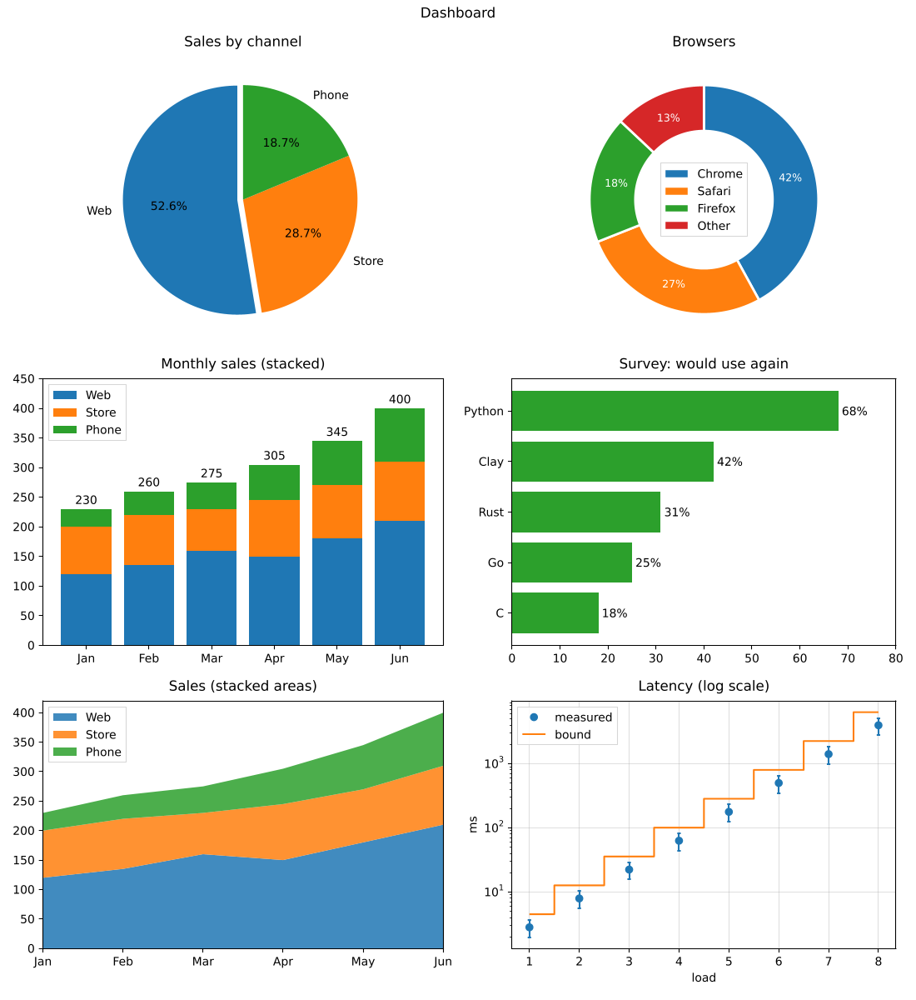
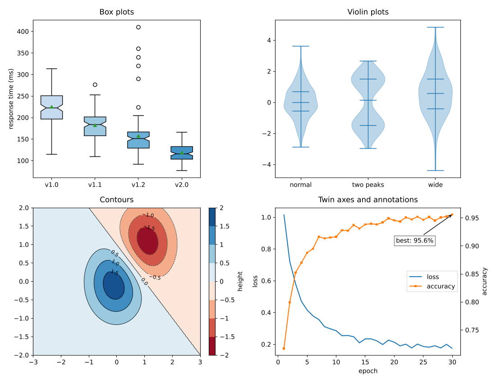
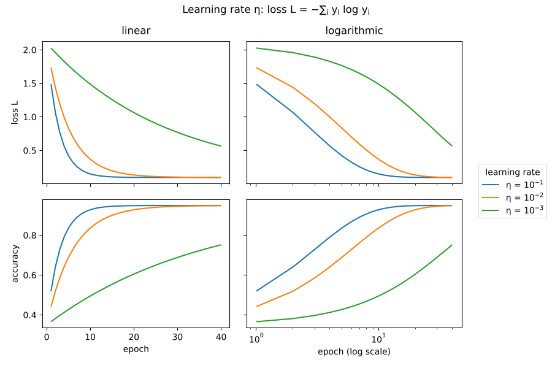
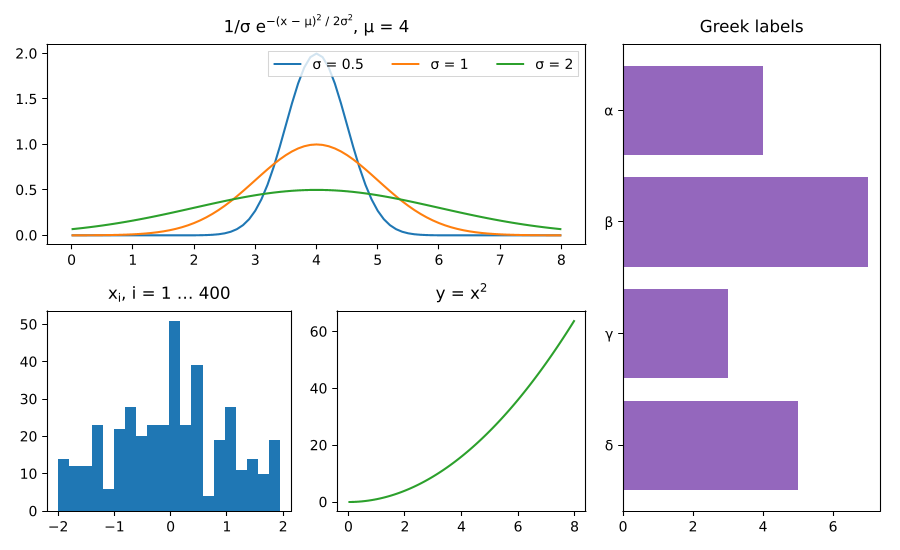
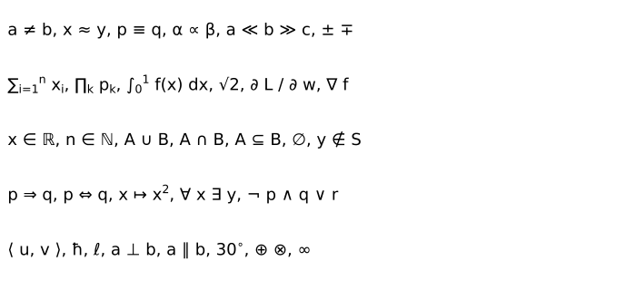
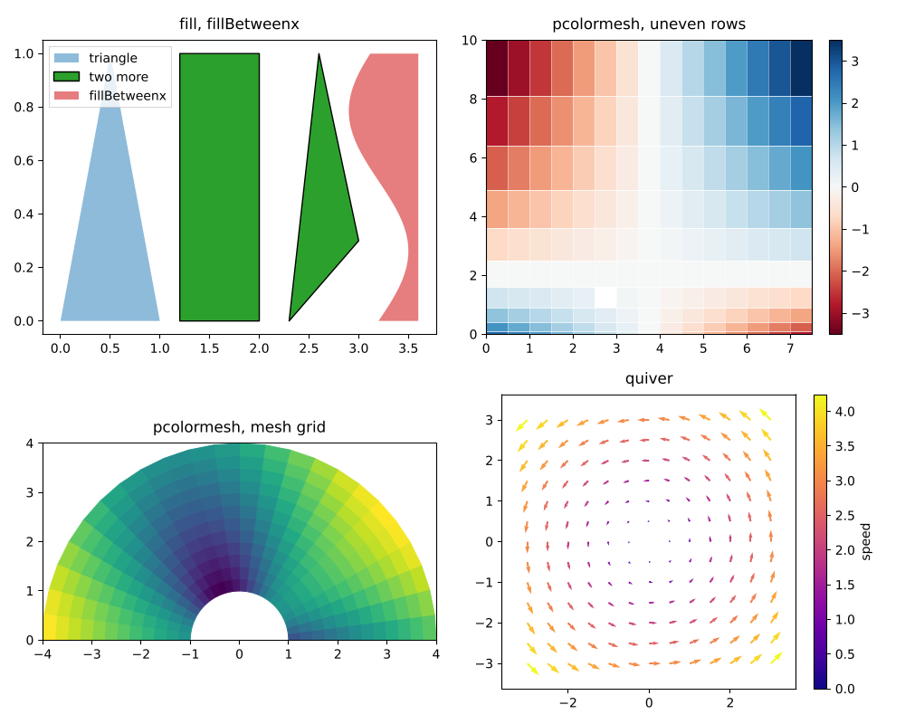
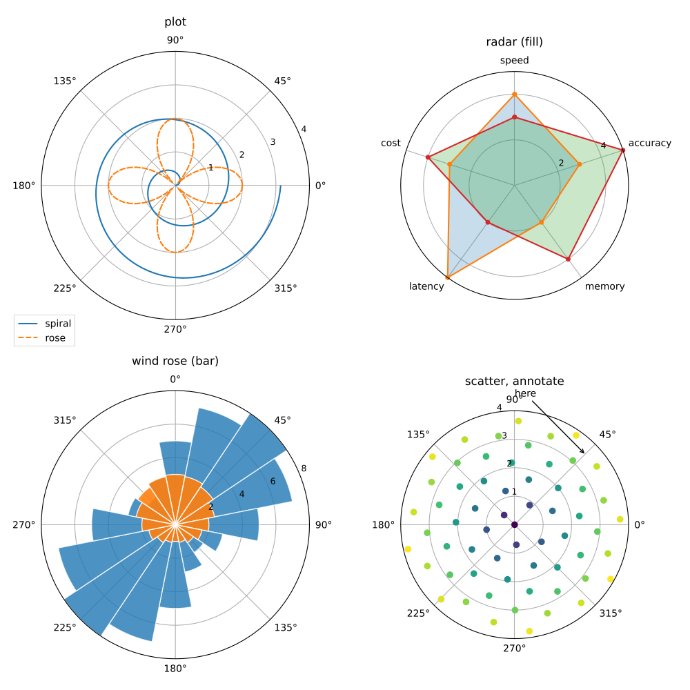
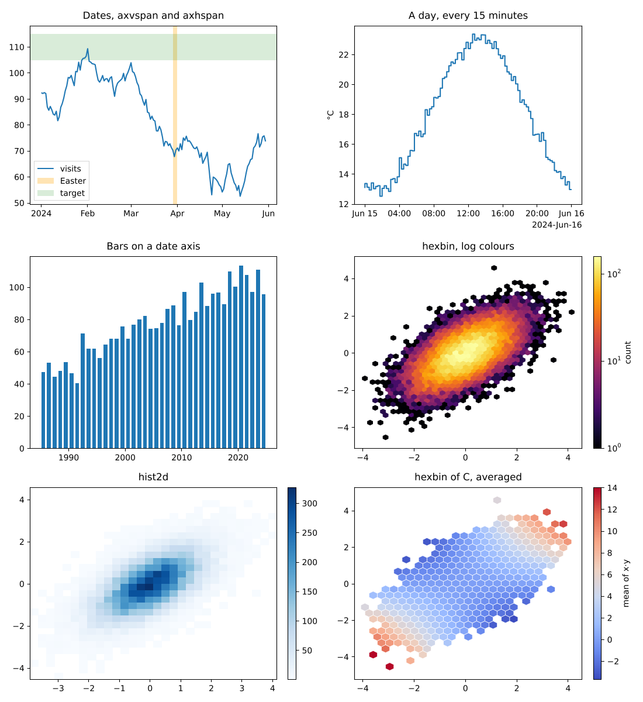

# Guide

[← Back to the README](../README.md)

Plot types by example. Each section's figure comes from a script in [`examples/`](../examples);
the [API reference](api.md) has every option.

- [Dashboards](#dashboards)
- [Distributions, fields and annotations](#distributions-fields-and-annotations)
- [Layout and math text](#layout-and-math-text)
- [Fields and polar axes](#fields-and-polar-axes)
- [Dates and densities](#dates-and-densities)

## Dashboards

Pies and donuts, stacked bars with their totals, stacked areas, error bars and log scales,
from [`examples/dashboard.clay`](../examples/dashboard.clay):

```clay norun
ax pie(shares, #{labels: ["Web", "Store", "Phone"], autopct: "%1.1f%%", startangle: 90})
ax pie(browsers, #{autopct: "{:.0f}%", wedgeprops: #{width: 0.4, edgecolor: "white"}})   // a donut

ax bar(months, web, #{label: "Web"})                       // stacked bars: bottom is the bars below
top = ax bar(months, store, #{bottom: web, label: "Store"})
ax barLabel(top, #{fmt: "{:,.0f}", padding: 2})

ax stackplot(days, [web, store, phone], #{labels: ["Web", "Store", "Phone"]})
ax errorbar(xs, ys, #{yerr: errs, fmt: "o", capsize: 3})
ax yscale("log")
```



For grouped bars, shift each group's positions by a bar width:
`ax bar(xs map { |x| x - 0.2 }, a, #{width: 0.4})`, `ax bar(xs map { |x| x + 0.2 }, b, #{width: 0.4})`,
then `ax xticks(xs, names)`.

## Distributions, fields and annotations

Box plots and violins, filled and labelled contours, and twin axes with an annotation, from
[`examples/statistics.clay`](../examples/statistics.clay):

```clay norun
ax boxplot(#{"v1.0": a, "v1.1": b, "v1.2": c}, #{notch: true, showmeans: true, patchArtist: true})
ax violinplot([x, y, z], #{showmedians: true, quantiles: [0.25, 0.75], labels: names})

cf = ax contourf(xs, ys, z, 10, #{cmap: "RdBu"})           // Z as rows; xs per column, ys per row
cs = ax contour(xs, ys, z, cf get("levels"), #{colors: "k", linewidths: 0.6})
ax clabel(cs, #{fmt: "%.1f"})
ax colorbar(cf, #{label: "height"})

ax plot(epochs, loss, #{label: "loss"})
acc_ax = ax twinx                                          // shares x; its own y axis on the right
acc_ax plot(epochs, acc, "s-", #{label: "accuracy"})
acc_ax annotate("best", [best, acc max], #{xytext: [-90, -45], textcoords: "offset points",
                                           arrowprops: #{arrowstyle: "->"}, bbox: #{fc: "white"}})
ax legend                                                  // lists both axes' lines
```



## Layout and math text

Shared axes, a mosaic of axes spanning cells, legends beside the axes or in columns, and math
in any text, from [`examples/layout.clay`](../examples/layout.clay):

```clay norun
[fig, axs] = Plot subplots(2, 2, #{sharex: "col", sharey: "row"})
axs at(0) at(0) plot(epochs, loss, #{label: "$\\eta = 10^{-1}$"})
axs at(0) at(0) ylabel("loss $\\mathcal{L}$")
fig suptitle("Learning rate $\\eta$: loss $\\mathcal{L} = -\\sum_i y_i \\log \\hat{y}_i$")
fig legend(#{loc: "outside right", title: "learning rate"})
```



```clay norun
[fig, m] = Plot subplotMosaic(["AAD", "BCD"])     // A over two columns, D over two rows
m get("A") legend(#{ncol: 3})
ax legend(#{bboxToAnchor: [1.02, 1], loc: "upper left"})   // beside the axes
```



Text between `$` signs is math, in TeX's notation: `^` raises and `_` lowers the next character
or `{group}`, and they nest (`$e^{-x^2}$`); `\alpha` to `\omega` and `\Gamma` to `\Omega` are
Greek letters; operators and relations (`\pm \times \cdot \neq \approx \equiv \leq \ll
\propto \perp \parallel`), big operators (`\sum \prod \int \sqrt{x}`), calculus (`\partial
\nabla \infty`), arrows (`\rightarrow \Rightarrow \Leftrightarrow \mapsto`), sets (`\in
\notin \subset \subseteq \cup \cap \emptyset`, `\mathbb{R}` and N, Z, Q, C), logic
(`\forall \exists \neg \land \lor`) and others (`\langle \rangle \hbar \ell \oplus \otimes
\circ \ldots`) are their symbols; `\sin`, `\log`, `\exp`, `\max` and their kind are written
upright; `\frac{a}{b}` reads a/b; font commands (`\mathrm`, `\mathcal`, `\mathbf`,
`\text`...) and accents (`\hat`, `\bar`, `\tilde`) show their letters as they are; and `-` is
a minus sign. It works in every text: titles, labels, tick labels, legends, annotations. `\$`
is a dollar sign, and a lone `$` is just text. In Clay strings a backslash is written `\\`, so
`"$\\sigma^2$"` gives σ².



## Fields and polar axes

Polygons, meshes of cells and vector fields, from [`examples/fields.clay`](../examples/fields.clay):

```clay norun
ax fill(xs, ys, #{alpha: 0.5})
ax pcolormesh(X, Y, C, #{cmap: "RdBu", edgecolors: "white"})    // X, Y: edges, centres or mesh grids
ax quiver(xs, ys, U, V, speed, #{cmap: "plasma"})
```



Polar axes take angles in radians and radii. Lines and fills go straight between their points
(they don't follow the circle), bars become wedges, and `xticks` names the spokes, which makes radar charts
and wind roses:

```clay norun
[fig, axs] = Plot subplots(2, 2, #{projection: "polar"})
ax setThetaZeroLocation("N")                  // 0 at the top
ax setThetaDirection(-1)                      // clockwise
ax xticks(angles, ["speed", "accuracy", "memory", "latency", "cost"])
ax fill(angles, values, #{alpha: 0.25})       // a radar chart
ax bar(directions, counts, #{width: 0.39})    // a wind rose
```



| Polar axes | |
|---|---|
| `setThetaZeroLocation(loc, offset)` | Where angle 0 points: `"E"` (the default), `"N"`, `"W"`, `"S"` or between (`"NE"`), plus an offset in degrees |
| `setThetaDirection(d)` | 1: angles grow anticlockwise (the default); -1: clockwise |
| `setRmax(r)`, `ylim(0, r)`, `rlim(0, r)` | The radius at the edge (by default the data's, rounded up) |
| `setRticks(values)`, `yticks(values)` | The radii marked with circles |
| `setRlabelPosition(degrees)` | Where the radius labels sit (22.5) |
| `xticks(angles, labels)`, `setThetagrids(degrees, labels)` | The spokes: angles in radians (or degrees) and their labels |

## Dates and densities

Dates on the x axis, shaded spans, and many points as hexagons or a 2-D histogram, from
[`examples/dates_density.clay`](../examples/dates_density.clay):

```clay norun
ax plot(["2024-01-01", "2024-01-02", ...], visits)        // or Date objects
ax axvspan("2024-03-29", "2024-04-01", #{color: "orange", alpha: 0.3, label: "Easter"})
ax axhspan(105, 115, #{color: "green", alpha: 0.15})

ax hexbin(xs, ys, #{gridsize: 40, bins: "log", cmap: "inferno"})
[counts, xedges, yedges, h] = ax hist2d(xs, ys, 30, #{cmin: 1})
```



Dates are `Date` objects or text, `"2024-03-15"`, `"2024-03-15 09:30"` or `"2024-03-15T09:30:15"`, in
`plot`, `scatter`, `step`, `fillBetween`, `errorbar`, `stackplot`, `axvline`, `axvspan`, `text`,
`annotate` and `xlim`, and as `Date` objects in `bar` (text in `bar` names categories).
Ticks go on years, months, days, hours, minutes or seconds, whichever fit, and are
labelled briefly: a month's first day shows the
month and a year's first month the year, with what the labels leave out (`2024-Feb`) under the
end of the axis. Dates are taken as their clock time, as `Date` shows them, without time zones.
On a date axis, `xlim` gives days since the first date plotted (Clay's 32-bit floats can't
hold days since 1970 finer than a few minutes); `PlotDates` has the calendar sums.
