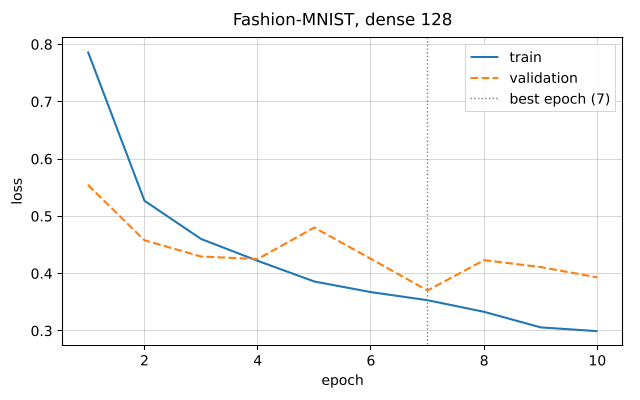
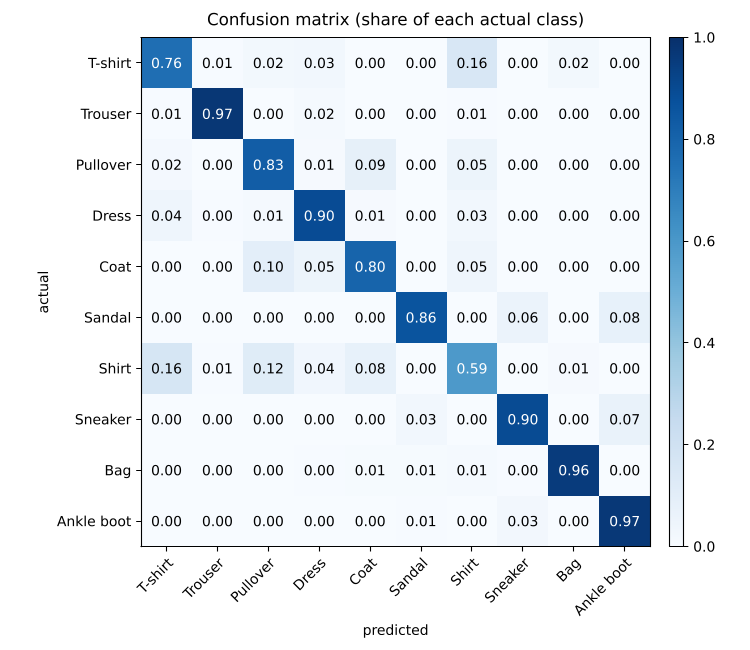
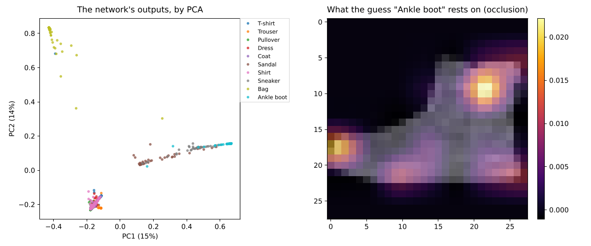
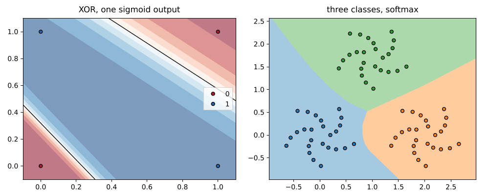
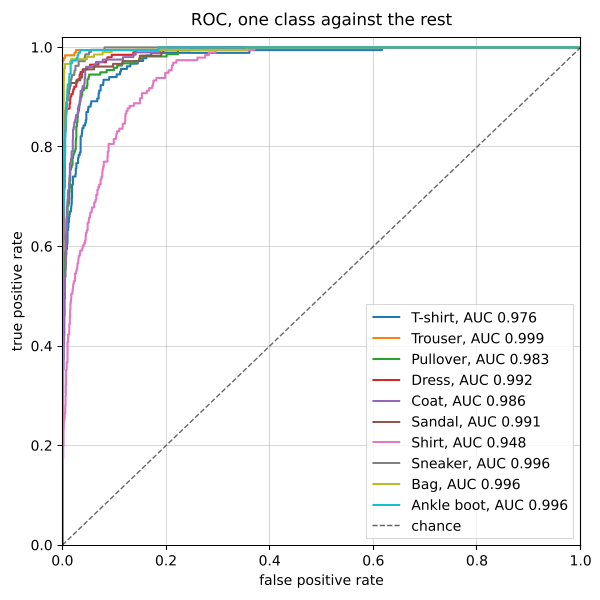
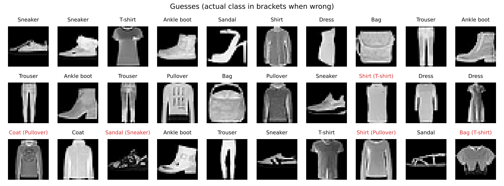
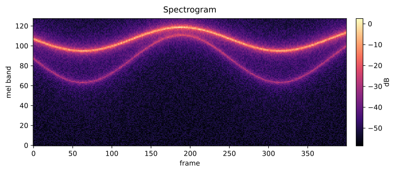

# Machine learning

[← Back to the README](../README.md)

Plots for training and evaluating models. They take
plain Arrays of numbers (or anything with `toArray`, such as clay-ann's `AnnData`), so they work
with [clay-ann](https://github.com/mseminatore/clay-ann) without depending on it. The figures
below are from [`examples/fashion_mnist.clay`](../examples/fashion_mnist.clay): a small network
trained on Fashion-MNIST with clay-ann.

| | |
|---|---|
| `learningCurve(history, opts)` | Loss per epoch, from what clay-ann's `fit` returns (a Dict per epoch), `net history` rows (`[loss, learningRate, validationLoss]`, -1 for none), an Array of losses, or a Dict of named series (`#{loss: [...], accuracy: [...]}`). Marks the best epoch: the lowest validation loss (or training loss); `best:` an epoch number or `false`. Also `title`, `xlabel`, `ylabel`. |
| `confusionMatrix(matrix, opts)` | A confusion matrix (rows: actual class) as a heatmap with its values in the cells, in black or white to stand out. `labels` (class names), `normalize` (`"true"`: each row sums to 1, `"pred"`: columns, `"all"`), `cmap` (`"Blues"`), `colorbar` (`true`), `annotate` (`true` up to 30 classes), `rotation` (of the x labels), `title`. |
| `roc(scores, targets, opts)` | ROC curves with their AUC. `scores` are numbers (higher: more likely positive) with targets 1/0 or true/false, or rows of class scores (one curve per class, one against the rest) with targets as class numbers or one-hot rows. `labels`, `label`, `chance` (`true`: the diagonal), `title`. Returns the curve, `#{fpr:, tpr:, thresholds:, auc:}`, or one per class. |
| `precisionRecall(scores, targets, opts)` | Precision-recall curves with their average precision, the same way. Returns `#{precision:, recall:, thresholds:, ap:}` (or one per class). |
| `decisionBoundary(model, inputs, labels, opts)` | What a classifier decides across the plane of its two inputs, with the data on top. `model` is a clay-ann network (anything with `predictBatch`), or a block from a row `[x, y]` to its outputs or class. With one output (a probability), the plane is shaded red to blue with a line at 0.5; with several, each class's region is filled in its colour. `labels` (optional): a class per row, or one-hot rows. Options: `resolution` (100 points a side), `margin` (0.1 of the data's span), `cmap` (`"RdBu"`), `classNames` (adds a legend), `s` (marker area). |
| `embedding(rows, labels, opts)` | Rows of numbers (embeddings, a layer's outputs) in two dimensions by PCA, coloured by class, the axes labelled with the share of the variance they hold. `classNames` (a legend), `s`, `alpha`. Returns `pca`'s result. |
| `Plot pca(rows, k, opts)` | Principal components (`PlotML pca`): `#{projected:, components:, explained:, mean:}`. Pure Clay: quick for up to a few hundred dimensions; fitted on `maxRows` rows at most (2000), every row projected. Data with its own `pca(k, maxRows)` method is asked for it: clay-ann's `AnnData` computes it in C (all of MNIST in a few seconds), fitted on every row unless `maxRows` is given. |
| `Plot weightHistograms(layers, opts)` | A new figure of one histogram per layer of weights, titled with their mean and standard deviation: a Dict of name to weights, an Array of them, or a network with `weights(i)` and `layerCount` (clay-ann's: one histogram per layer that has weights, titled with its index and kind, e.g. "1 dense"). `bins` (40), `cols`, `range` (the same for every layer, to compare frames of a `Plot movie`), `title`. |
| `overlay(image, heat, opts)` | A heatmap (a saliency map, activations) of any size, scaled smoothly to the image and blended over it. `cmap` (`"inferno"`), `alpha` (0.5), `vmin`, `vmax`, `imageCmap` (`"gray"`), `colorbar`. |
| `Plot imageGrid(images, opts)` | A new figure of images, one per axes: rows, flat Arrays or `Image`s. `cols` (up to 10), `shape`, `cmap` (`"gray"`), `vmin`, `vmax`, `symmetric` (`true`: one range centred on 0 for all, with `"coolwarm"`, for weights and filters), `titles`, `predicted` and `actual` (class numbers or rows of scores: titled with the prediction, and the actual class in red when wrong), `labels` (class names), `title`, `size` (inches per image). Returns the figure. |

All but `imageGrid`, `pca` and `weightHistograms` are axes methods too (`ax roc(...)`). `PlotML rocCurve(scores, targets)`,
`PlotML prCurve(scores, targets)` and `PlotML confusion(actual, predicted)` compute without
drawing, and `PlotML argmax(row)` is the class a row of scores picks.

```clay
history = net fit(xTrain, yTrain, #{"epochs": 12, "validation": [xValid, yValid], "patience": 3})
Plot learningCurve(history)
Plot savefig("history.png")
```



```clay
names = ["T-shirt", "Trouser", "Pullover", "Dress", "Coat", "Sandal", "Shirt", "Sneaker", "Bag", "Ankle boot"]
Plot figure(#{figsize: [7.5, 6.5]})
Plot confusionMatrix(net confusionMatrix(xTest, yTest), #{labels: names, normalize: "true", rotation: 45})
```



```clay
probs = (net predictBatch(xTest)) toArray
ax embedding(probs, labels, #{classNames: names})       // the outputs, by PCA
ax overlay(image, heat)                                  // heat: e.g. occlusion, 7 x 7
```



The saliency map is occlusion: blank each 4 x 4 patch of the image and see how much the
network's probability for its guess drops (in `examples/fashion_mnist.clay`). It needs only
`predict`, so it works with any model.

```clay
net train(points, targets)                     // two inputs per row
Plot decisionBoundary(net, points, targets)    // targets: classes, or one-hot rows
```



```clay
probs = (net predictBatch(xTest)) toArray      // a row of 10 probabilities per image
Plot roc(probs, labels, #{labels: names})       // labels: the class number of each image
```



```clay
guesses = probs map { |p| PlotML argmax(p) }
Plot imageGrid((0..29) map { |k| xTest row(k) }, #{cols: 10, predicted: guesses slice(0, 30),
               actual: labels slice(0, 30), labels: names})
```



Weight matrices, convolution filters and spectrograms are `imshow` too: a diverging map such
as `coolwarm` with `vmin: -m, vmax: m` suits weights, and `Plot imageGrid(filters,
#{symmetric: true})` shows a layer's filters on one shared scale. A spectrogram, one row per
mel band, lowest band at the bottom:

```clay
Plot figure(#{figsize: [8, 3.5]})
Plot imshow(spec, #{origin: "lower", aspect: "auto", cmap: "magma"})
Plot colorbar(#{label: "dB"})
Plot xlabel("frame"); Plot ylabel("mel band")
```


