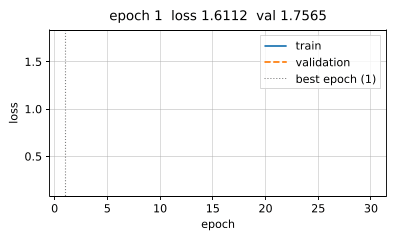
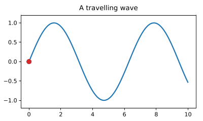

# Output

[← Back to the README](../README.md)

Besides `savefig` to PNG, SVG and PDF files, a figure can become an animation, be drawn as text
in a terminal, or be placed inside a larger PDF document.

- [Animation](#animation)
- [In the terminal](#in-the-terminal)
- [PDF](#pdf)

## Animation

Animated GIFs (and animated PNGs) of a figure as it changes, from
[`examples/animation.clay`](../examples/animation.clay):

```clay norun
// update the figure for each frame
anim = Plot animate(fig, 30, { |i| wave set("ys", xs map { |x| Math sin(x - (i / 5.0)) }) }, #{interval: 60})
anim save("wave.gif")                     // or "wave.png": an animated PNG

// or grab frames yourself
movie = Plot movie(#{fps: 6})
steps each { |s| ax clear; draw(ax, s); movie grab(fig) }
movie save("histogram.gif")

// a training run replayed, an epoch a frame, on axes fixed to the final ranges
live = Plot liveCurve
net fit(x, y, #{"epochs": 30, "onEpoch": live})
live animation save("training.gif")
```

 

| | |
|---|---|
| `Plot animate(fig, frames, update, opts)` | An animation. `frames` is a count (0 to n - 1), a Range or an Array; `update` is called with each before that frame is drawn, and may instead return a figure to draw. Options: `interval` (milliseconds a frame, 200) or `fps`, `dpi`, `loop` (0: for ever) or `repeat: false`, `colors` (a GIF's, up to 256). `anim save(path)` writes `.gif`, or `.png` / `.apng` for an animated PNG; `anim images` gives the frames as Images. |
| `Plot movie(opts)` | A movie to add frames to: `movie grab(fig)` (the current figure if left out) after each change, then `movie save(path)`. Options as `animate`'s; `fps` is 10 by default. |
| `live animation(opts)` | A `liveCurve`'s training replayed, on axes fixed to the final ranges. `every` (a frame every n epochs), and `animate`'s options (`interval` 100). |

The frames are drawn as `savefig`'s PNGs are, and encoded by [clay-image](https://github.com/mseminatore/clay-image).
A GIF has at most 256 colours, shared by all its frames: charts usually have fewer, and are kept
exactly; otherwise the palette is learnt from the frames (NeuQuant), keeping the most used
colours exact. Each frame stores only what changed, so the GIFs above are 47 KB and 96 KB.
Animated PNGs are full colour but larger, and some viewers show only their first frame.

## In the terminal

Any figure can be drawn as text: lines, markers and fills in Braille dots (2 x 4 to a
character), images in half blocks, all in 24-bit colour. It suits SSH sessions and watching a
network train.

```clay
Plot plot(epochs, train, #{label: "train"})
Plot plot(epochs, valid, "--", #{label: "validation"})
Plot title("Learning curve"); Plot legend
Plot show(#{terminal: true})        // or: Plot toText(#{cols: 64, rows: 16}) print
```

```text

                           Learning curve
      ⢠⠤⠤⠤⠤⠤⠤⠤⠤⠤⠤⠤⠤⠤⠤⠤⠤⠤⠤⠤⠤⠤⠤⠤⠤⠤⠤⠤⠤⠤⠤⠤⠤⠤⠤⠤⠤⠤⠤⠤⠤⠤⠤⠤⠤⠤⠤⠤⠤⠤⠤⠤⠤⠤⠤⢤
      ⢸  ⡇                                 ⢸⠉⠉⠉⠉⠉⠉⠉⠉⠉⠉⠉⠉⠉⠉⠉⠉⢹⢸
  1.0 ⢸  ⣏                                 ⢸⠉⠉⠉⠉⠁ train     ⢸⢸
      ⢸  ⢸⡆                                ⢸⠤⠤⠄⠠⠄ validation⢸⢸
      ⢸  ⠈⣦                                ⠸⠤⠤⠤⠤⠤⠤⠤⠤⠤⠤⠤⠤⠤⠤⠤⠤⠼⢸
      ⢸   ⢹⠄                                                 ⢸
  0.5 ⢸   ⠈⢲⠢⡀                                               ⢸
      ⢸     ⠑⢆⡢⠤⡀                                            ⢸
      ⢸       ⠈⠑⠒⠬⠭⣇⣀⣒⡒ ⠠⠤⠄ ⠤⠤⠄⢀⣀⣀ ⣀⣀⡀⢀⣀⣀⢀⣀⣀⡀⣀⣀⣀⢀⣀⣀⡀⢀⣀⣀ ⣀⣀   ⢸
      ⢸               ⠈⠉⠉⠉⠉⠉⠑⠒⠒⠒⠒⠒⠒⠒⠒⠒⠒⠒⠒⠒⠤⠤⠤⠤⠤⠤⠤⠤⠤⠤⠤⠤⠤⠤⠤⠤⠤⠄ ⢸
      ⠈⠉⠉⠉⠉⠉⠉⠉⠉⠉⠉⠉⠉⠉⠉⠉⠉⠉⠉⠉⠉⠉⠉⠉⠉⠉⠉⠉⠉⠉⠉⠉⠉⠉⠉⠉⠉⠉⠉⠉⠉⠉⠉⠉⠉⠉⠉⠉⠉⠉⠉⠉⠉⠉⠉⠉
       0        5       10      15       20       25      30

                                epoch
```

| | |
|---|---|
| `toText(opts)` | The figure (`fig toText`, or `Plot toText` for the current one) as a String of lines. `cols` (the `COLUMNS` variable, or 80), `rows` (from the figure's shape, at most `LINES` - 1), `color` (`true` when writing to a terminal; `false` for plain text). |
| `show(#{terminal: true})` | Print it rather than open a viewer. On Linux without a display (`DISPLAY` and `WAYLAND_DISPLAY` unset), `show` does this by itself. |
| `Plot liveCurve(opts)` | A learning curve redrawn in place after every epoch: pass it as clay-ann `fit`'s `onEpoch`. Writing to a file or pipe instead, it prints a line per epoch. Options: `cols`, `rows` (20), `color`, `every` (redraw every n epochs), `title`, and `learningCurve`'s. `live savefig("loss.png")` saves the finished curve, `live animation save("training.gif")` replays it an epoch a frame (see [Animation](#animation)); `live history` has the epochs; `live value(loss)` adds one by hand. |

```clay
live = Plot liveCurve
history = net fit(xTrain, yTrain, #{"epochs": 30, "validation": [xValid, yValid], "onEpoch": live})
live savefig("history.png")
```

`examples/fashion_mnist.clay --live` shows it. Text is laid out at a size where 10-point type
is one row, so ticks, labels, legends and colour bars come out as in the pictures, at
character resolution. Black and white draw in the terminal's own text colour, so charts read on
dark and light backgrounds alike. The terminal needs a font with Braille characters (Windows
Terminal, macOS Terminal and most Linux terminals have one; the old Windows console host's
fonts do not).

## PDF

`savefig("f.pdf")` writes a one-page PDF the figure's size: vector lines, shapes and text,
sharp at any zoom, with images embedded as PNG. `drawPdf` puts a figure inside a larger
document, between paragraphs of a report:

```clay norun
import("plot")

doc = Pdf new()                                   // Pdf, PdfPage, PdfFlow: clay-pdf
flow = doc flow(72)
flow font("Helvetica-Bold", 16) paragraph("Training report")
flow font("Helvetica", 11) paragraph("Loss fell steadily for 40 epochs.")

fig = Plot figure(#{figsize: [6, 3]})
Plot plot(losses)
Plot title("Loss")
h = flow width * 0.5                              // a 6 x 3 figure, full width
page = flow ensure(h)                             // a new page if it won't fit
fig drawPdf(page, flow x, flow y, flow width)
flow advance(h)
flow paragraph("The validation loss followed it.")
doc save("report.pdf")
```

Text is Helvetica, one of the fonts every PDF reader has (none is embedded), measured with
its metrics, so the layout differs a little from PNG and SVG; it covers Windows-1252
(Western European letters, `°`, `µ`, `·`), and other characters show as `?`. Viewers smooth
images they enlarge, so a small image (a 28 x 28 `imshow`) is enlarged into blocks first
(about 4 pixels a point).
